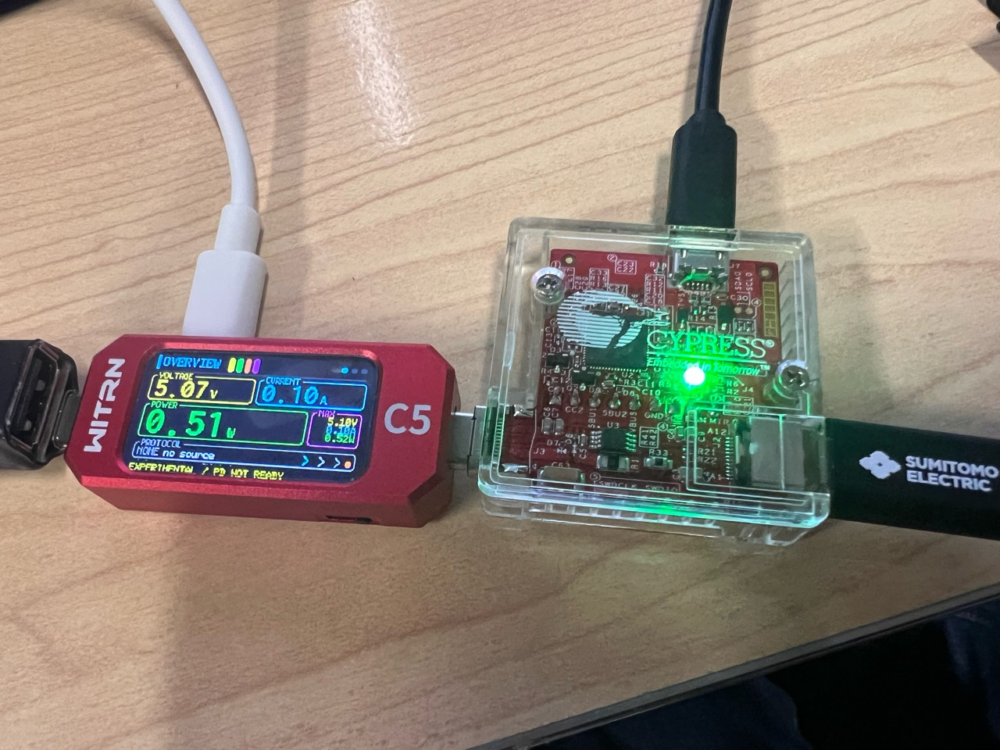
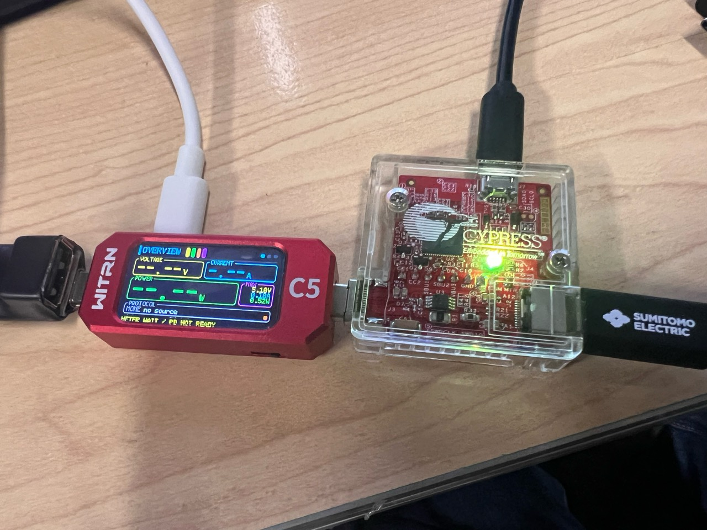

# WITRN C5 standalone Rust firmware

正本は [English README](README.md) です。開発文書は英語を正、日本語を補助とします。

[KWS-X1用Rustファームウェア](https://github.com/inuchanbt/kws-x1-standalone-rs)の
GUI・計測・PD機能をWITRN C5へ移植するプロジェクトです。
**2026-11-17時点の最新候補はv0.1.9、Overview実測表示の第一段階まで実機確認済みです。**
所有機1台で電圧・電流・電力・RAM内MAX、停止後の「--」とMAX保持を確認しました。
積算・グラフ・PD等を含む完成した計測器ファームウェアには、引き続き開発が必要です。

確認結果は [STATUS.md](docs/STATUS.md)、版ごとの経緯は
[CHANGELOG.md](docs/CHANGELOG.md)、次の工程は [PORTING.md](docs/PORTING.md) にまとめています。

## 現在できること

- 固定した上流のRust描画・ナビゲーションを使用する17ページと設定画面。
- 元GUIの240×135を、縦横比を保った306×172でC5の320×172画面中央へ表示。
- 物理配置 **Back / Left(-) / OK / Right(+)** に合った4ボタン。
  対応ピンはPB14 / PB15 / PA13 / PA14です。
- 手動180度反転、反転時の左右ボタン交換、明るさ変更。
  表示設定はRAM内のみで、電源断により初期値へ戻ります。
- C5実機で識別したINA228から、変換完了フラグの0→1を確認して取得。
- 起動時に外部設定の先頭240バイトを二重読み取りし、一致・4区画のチェックサム・
  値の範囲を確認したうえで、自動取得とOverview/MAX更新を開始。
- HID診断、ホストテスト、パッケージ検証、全Flash二重読み出しによる保存領域監査。

実際の5 V・0.1 A試験時の画面です。



取得停止後、主表示は未取得の「--」となり、MAXは残ります。



写真は所有機の画面記録です。精度保証やホスト描画によるプレビューとは区別しています。

## 実験表示の範囲と未実装機能

表示範囲は **0〜5.5 V、電流絶対値1.1 A以下** です。取得後500 msを超えた値、
異常値、範囲外の値は未取得表示に戻します。この範囲制限は表示用で、給電を遮断しません。
電流の符号はテレメトリーに保持し、元GUIは絶対値と方向表示を使用します。
MAXは起動後のRAM内記録で、取得停止後も残り、電源断で消えます。

積算・グラフへの接続、D+/D-/CC電圧、リップル用ADC、C5のPD受信・能動制御、
ケーブル／充電器照会、QC/SCP/FCP/AFC、永続保存は未実装です。
空のプロトコル画面は充電器の対応判定ではありません。対応していない操作は無効です。

所有機の設定値を実行時に読み取りますが、校正の由来や全範囲精度は未確定です。
センサー設定値・外部保存データ・実行中Flashの書き込みは行いません。
状態レジスターの読み取りによって、保持フラグがクリアされる場合があります。
詳細は [METER-DISPLAY.md](docs/METER-DISPLAY.md) を参照してください。

## 確認できたこと

- v0.1.1でボタン配置の一致を所有者が確認。
- v0.1.5で外部2 KiBの二重読み取りとチェックサム、GUI継続動作を確認。
  v0.1.4で発生したLCDタイムアウトは、I²C処理を描画の外へ移して修正しました。
- v0.1.8で変換完了フラグを使った取得と、5 V・0／0.1／0.5／1 Aの連動比較を確認。
- v0.1.9でHIDのみの75件の表示値更新、負荷時の生データ／表示値照合、
  所有者の目視と写真による数値・MAX・停止後の表示を確認。
- v0.1.9の全Flashを2回読み出し、一致・インストール済みファーム・保存領域を監査。
- ファーム作成時はRust統合テスト11件、Python／nativeテスト85件が成功。
  その後のホスト側検証追加を含む公開前の結果は [STATUS.md](docs/STATUS.md) を参照。

これらは所有機1台と限定した条件での結果です。ホストテスト・静的解析・実機結果を
区別し、一般的な互換性や全範囲精度は主張していません。

## ファームと実機操作

所有環境の検証済みパッケージは次の場所です。

`build/gui-v0.1.9-meter-display/C5-standalone-GUI-v0.1.9-meter-display.c4ser`

SHA-256: `f05abfd3bfa141f498099c2d27dd9349c0ba49a61d34560581d0f0abcc9f830d`

生成ファーム・生ログ・所有機バックアップはGit管理対象外です。
今回のソース公開にはダウンロード用ファームのReleaseは含めていません。
ARM版の作成と監査には、スクリプトが指定する所有機の検証済みブートローダー／
バックアップが必要です。これらのベンダー製バイナリーは配布しません。
対象は確認済み2024-08-06ブートローダーで、別版への互換性は未検証です。

書き込む場合はOKを押しながら再接続してDFUに入り、公式WITRN更新ツールを使用します。
現在のアプリが置き換わるため、所有環境の動作確認済みDOOM v7を戻し用に保存しています。
更新ツールを閉じ、OKを押さずに通常起動してください。
KWS-X1用フラッシャーをC5へ使用しないでください。

左右でグループを選び、OKでグループ内へ入り、Backで戻ります。
OverviewでBackを押すと設定です。BrightnessとRotationをOKで開き、左右で変更します。

```powershell
cd D:\c5_standalone_rs
.\monitor.ps1
.\display-monitor.ps1 --seconds 20 --stop
```

他のC5 HIDクライアントを閉じて使用します。通常モニターは取得を停止しません。
表示モニターの`--stop`は取得を停止し、主表示の無効化を確認します。
STOP後の自動取得再開には通常再起動が必要です。

明示的な生レジスター取得や外部保存領域の二重読み取りは、自動取得停止後に行います。

```powershell
.\probe-meter.ps1 --raw --samples 5
.\backup-storage.ps1
```

全Flash監査は、所有者が主計測側を外してDFUへ戻した後に実行します。

```powershell
.\verify.ps1 --dfu
```

監査の既定対象はv0.1.9です。旧版を新版のパッケージで監査しないでください。
監査スクリプトは読み取り専用で、書き込み・復旧は行いません。

## ビルドと作業フォルダー

作業先は **`D:\c5_standalone_rs`** です。`Cargo.toml`は直下にあります。
旧`D:\doom_on_c5\c5-standalone-rs`は全2,942ファイルを移設先へ保管・SHA-256照合した後、
削除しました。詳細は [MIGRATION.md](docs/MIGRATION.md) に記録しています。

```powershell
.\build.ps1 --host --cargo-home D:/c5_standalone_rs/.cache/cargo
.\build.ps1 --cargo-home D:/c5_standalone_rs/.cache/cargo
& 'C:\Users\James\AppData\Local\Python\pythoncore-3.14-64\python.exe' -m unittest discover -s tools -p 'test_*.py' -v
```

所有環境のRust 1.99.1・LLVM・Pythonのパスが既定です。別環境ではラッパーのPythonパスを
調整するか、Python側へツールのパスを明示してください。オフラインビルドのため、
依存キャッシュは事前に用意する必要があります。ホストテストには所有機バックアップは不要です。
ホストの画像は実際のRust描画コードによるプレビューで、実機写真とは区別します。

`build/`・`target/`・`.cache/`は公開対象外です。校正データ、Flash／外部保存領域の
読み出し、移設時の旧Git情報を含む保存一式は、ローカルに保護しています。
公開用の確認結果と選んだ実機写真のみを`docs/`にまとめています。

## 上流とライセンス

コードごとの適用範囲、リンク済みファームの配布条件、依存物・フォントの注意点は
[LICENSE.md](LICENSE.md) に英日でまとめています。Rustクレートのライセンスを、
C5ファーム全体へのMITのみの許諾として扱わないでください。

上流は`a454c8e6ba5a84747ad6da2928a724e3e714945c`に固定しています。
`upstream-tree.json`が元のGit blobを、`upstream-patches.json`が巨大な初期化コピーを
避ける履歴バッファの変更1件を記録しています。描画・ナビゲーション本体は未変更です。
KWS-X1のIC・ピン・Flash配置をC5の仕様として流用していません。

上流はMIT／Apache-2.0、C5のnativeアダプターはGPL-2.0-or-later由来です。
リンク済みファームはGPL-2.0-or-later（`COPYING`）、新しいRustアダプターは
`Cargo.toml`に従いMIT OR Apache-2.0です。
