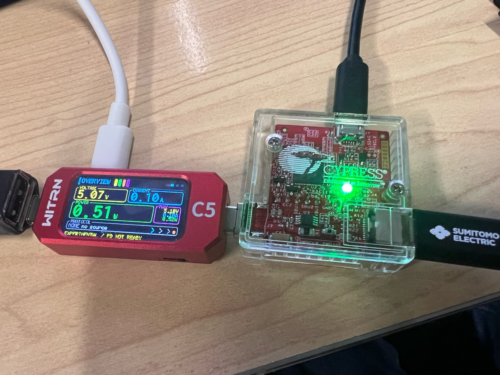
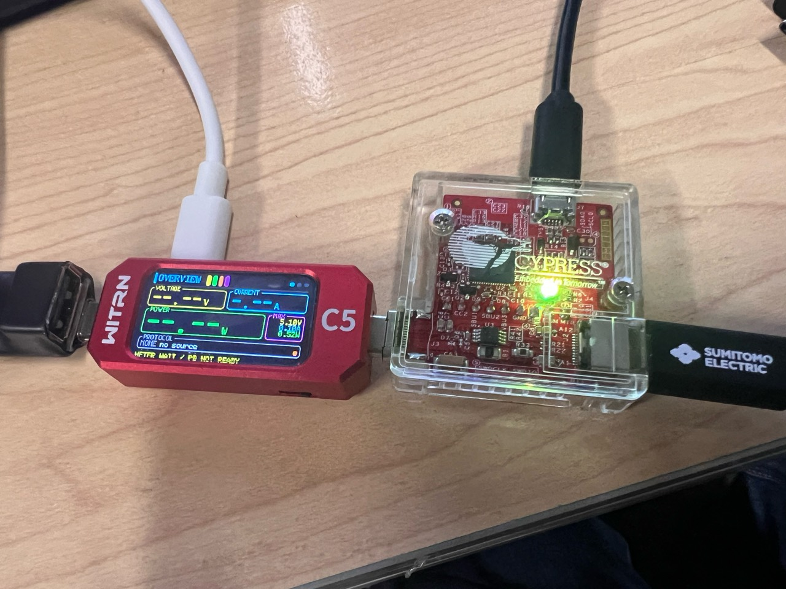

# WITRN C5 standalone Rust firmware

[日本語](README.ja.md)

Port of [inuchanbt/kws-x1-standalone-rs](https://github.com/inuchanbt/kws-x1-standalone-rs)
to WITRN C5. **Current candidate: v0.1.9 experimental live Overview.**
Voltage, signed current, power and RAM-only MAX now consume checked C5 samples.
HID-only display updates, stop invalidation, matched loaded raw/GUI conversion
and full dual internal-Flash auditing passed on the owner unit. The owner also
confirmed panel readings/MAX and missing main values with retained MAX after
STOP, supported by four photographs. The previous v0.1.8
passed HID-only acquisition, full dual internal-Flash audit and fixed-5 V
comparisons at 0, 0.1, 0.5 and 1 A. Private settings and earlier evidence remain
preserved. This is still not a completed power-meter firmware.

The candidate reads/checks the owner's settings at startup, then samples
without a PC. It supports an experimental 0..5.5 V / |I| <=1.1 A display envelope;
stale/error/outside-envelope values become unavailable. The bound does not
control the source or protect the power path. Graph, energy, line/ripple ADC
and charging protocols remain unimplemented. See [METER-DISPLAY.md](docs/METER-DISPLAY.md)
for limits, telemetry, read-to-clear effects and the first physical test.

As of **2026-11-17**, the first live Overview milestone is confirmed on one
owner C5. [Current status and validation](docs/STATUS.md) summarizes the evidence;
[development history](docs/CHANGELOG.md) records v0.1 through v0.1.9. English
documentation is authoritative; the Japanese README is the companion summary.

| Available now | Still to implement or qualify |
| --- | --- |
| 17 GUI pages plus settings, corrected four-button mapping | Measurement integration outside Overview/MAX |
| Rotation, brightness, RAM-only display settings | Persistent settings, energy totals and graphs |
| INA228 identification, checked settings and fresh gated samples | Wider voltage/current accuracy and calibration provenance |
| Experimental Overview voltage/current/power and MAX | D+/D-/CC ADC, ripple and C5 PD/protocol drivers |
| HID diagnostics, host tests and dual-Flash preservation audit | Broad device/revision compatibility |

Actual C5 screen during the 5 V / 0.1 A trial:



After acquisition stopped, the main values returned to dashes and MAX remained:



These are owner-device photographs, not host previews or accuracy certification.

## Implemented

- Unmodified upstream Rust renderer and navigation, pinned to commit
  `a454c8e6ba5a84747ad6da2928a724e3e714945c`.
- All 17 monitor, trigger and information pages, plus the settings screen.
- Logical 240 × 135 RGB565 framebuffer; proportional 306 × 172 scanout centered
  on the C5's 320 × 172 LCD. The small side margins preserve the original layout.
- Physical button order: **Back / Left(-) / OK / Right(+)**.
  Active-low pins: PB14 Back, PB15 Left, PA13 OK, PA14 Right.
- Manual 180° screen rotation, swapped arrow controls, and backlight adjustment.
  Settings are held in RAM and reset when power is removed. Auto rotation,
  energy-memory settings, timer changes and calibration are unavailable.
- Optional, read-only USB status monitor with sequence/nonce checks.
- Automatic runtime-checked settings and gated acquisition for experimental
  Overview/MAX; explicit diagnostics remain available after sampler STOP.
- Offline package checks, source provenance checks and post-install dual-read
  auditing, using the owner's previously verified C5 bootloader and flash map.

The GUI marks measurements experimental, or missing on wait/error/expiry. Empty
charging-protocol screens are UI states, **not charger capability test results**.
PD, PPS, AVS, QC, SCP, FCP, AFC and cable-query actions are blocked. No runtime
flash programming or voltage requests exist in this candidate.

## Firmware and installation on the owner's C5

The current diagnostic package is
`build/gui-v0.1.9-meter-display/C5-standalone-GUI-v0.1.9-meter-display.c4ser`.
Its SHA-256, memory sizes and build status are recorded in
`build/gui-v0.1.9-meter-display/manifest.json`. Earlier candidates and evidence remain
under `build/`, including the physically verified v0.1.1 and its source snapshot.
The tested package SHA-256 is
`f05abfd3bfa141f498099c2d27dd9349c0ba49a61d34560581d0f0abcc9f830d`.
Generated packages, raw captures and owner backups are local ignored build
outputs; they are not included in this source publication. This repository does
not currently provide a downloadable firmware release. Build-time manifests
retain their original untested flags; later physical results are summarized in
[STATUS.md](docs/STATUS.md).

1. Enter the C5's existing DFU mode by reconnecting with OK held.
2. Use the official WITRN updater to install the package. This replaces the current
   application. The accepted DOOM v7 package remains available in the previous
   C5 research directory for rollback.
3. Close the updater and reconnect without holding OK. The overview should open.
4. Test all four buttons, the groups and tabs. Back on the overview opens
   settings. Open Brightness or Rotation with OK, use the arrows to change it,
   and use Back to leave the edit. The unsupported settings rows stay closed.
5. Optional telemetry, after closing any other C5 HID client:

```powershell
cd D:\c5_standalone_rs
.\monitor.ps1
```

The monitor does not start the GUI or send DFU/PD commands. Ctrl+C stops only the
monitor. Check that `state=GUI`, the four key bits respond, the guard remains
above 1024 bytes, the image is correct in both orientations and the backlight
changes. Record any slow or missed presses together with `poll_gap_max`.

For an explicit meter-ID request and up to five raw snapshots:

```powershell
.\probe-meter.ps1 --raw --samples 5
```

After stopping autonomous acquisition with `display-monitor.ps1 --seconds 1 --stop`,
this reads fixed INA228 registers only after identifying the device. It does
not configure conversions or produce calibrated voltage/current readings.
Close other C5 HID clients first. See [METER-INVESTIGATION.md](docs/METER-INVESTIGATION.md).

After stopping autonomous acquisition, for two read-only captures of the stock-addressed external 2 KiB storage:

```powershell
.\backup-storage.ps1
```

The collector compares ascending/descending reads using separate nonces and
reports stock settings checksums. No storage-value writes or initialization/
repair tests are implemented. Private device data stay under ignored
`build/private-storage/`; never publish those files with source or firmware.

After the first physical test, reconnect in DFU and run the read-only audit:

```powershell
.\verify.ps1 --dfu
```

It reads the full internal flash twice, compares both copies, checks the
installed application's observed activation byte and verifies preservation
outside the bounded erase range. It cannot install or restore firmware.
The default audit target is v0.1.9 meter-display; `--build-dir` selects a different build
directory. Do not audit an older installed image against a newer package.

## Build and test

The owner's cached Rust 1.99.1 and LLVM tools are used by default. The scripts
accept explicit tool/cache/research paths; run `tools/build.py --help` for them.
No network access or USB device access is used during builds.
The dependency cache must already be populated for the enforced offline build.
Host tests do not require an owner Flash backup. ARM packaging additionally
requires the exact qualified owner baseline described in `tools/build.py`, and
DFU auditing requires the matching private baseline in `tools/verify.py`.
Those inputs are not distributed. The current PowerShell wrappers also name the
owner's Python installation; adapt that path for another workstation, or invoke
the Python entry points directly with explicit tool paths.

```powershell
.\build.ps1 --host --cargo-home D:/c5_standalone_rs/.cache/cargo
.\build.ps1 --cargo-home D:/c5_standalone_rs/.cache/cargo
& 'C:\Users\James\AppData\Local\Python\pythoncore-3.14-64\python.exe' -m unittest discover -s tools -p 'test_*.py' -v
```

Host previews are generated by the same Rust page code into `build/previews`.
They are not photographs or hardware emulation. The cross build enforces the
RAM/stack boundary and checks every upstream file against its Git blob hash.
It also rejects individual static stack estimates above 4 KiB. These estimates
sum downward SP adjustments in the generated ARM code; they are not a complete
call-tree/interrupt stack bound. Actual stack margin is reported by the monitor.
The native button regression test compiles the same GPIO decoder used by the
firmware and checks all 16 combinations of physical buttons, including unrelated
GPIO states. The Rust tests also exercise navigation and arrow swapping on flip.
Firmware outputs default to `build/gui-v0.1.9-meter-display`; `--output-dir` overrides this.

The working root is `D:/c5_standalone_rs`. Pass the local Cargo cache above to
keep build-time cache writes inside this project; the original dependency cache
was copied locally during migration. The wrappers resolve their Python tools
relative to `$PSScriptRoot`. External Rust/LLVM, research and rollback paths
remain intentional read-only inputs. See [migration evidence](docs/MIGRATION.md).

Relocation is complete: the old standalone subdirectory under `D:/doom_on_c5`
was removed after all legacy files were preserved and hash-verified in
`build/migration-completion-20261117-161436/legacy-workspace/`. Develop only from
the current root; the archived legacy tree is historical evidence.

## Hardware boundary

The board adapter uses the bootloader LCD/USB interface established by the C5
DOOM bring-up. It requires the owner's exact 2024-08-06 bootloader:

`aaf175a47bda0ad2f4a5b66f6759ac157b16fb4cccd565a13b63b0e182cab30d`

A runtime fingerprint rejects a different bootloader before calling private
entry points. This fingerprint is an accidental-mismatch guard, not secure boot.
The low 4 KiB of SRAM remain reserved for boot state; an 8 KiB stack plus at
least a 1 KiB guard are reserved. The linker and package model keep writes
inside `0x08004000..0x080E3FFF`. Factory/profile areas and option bytes are not
used for this port. No vendor firmware binary is distributed here.

See [PORTING.md](docs/PORTING.md) for the remaining work and hardware evidence.
For the next stage, qualify history/energy updates and their timing from the
validated sample path, then investigate line/ripple ADC and passive PD receive
before enabling active protocol operations.

## Source and licensing

`upstream/` contains the specified repository snapshot and its dual
MIT/Apache-2.0 license files, plus one C5 patch: a const empty-history constructor
for in-place initialization without large stack copies. Runtime history behavior
is unchanged. `upstream-tree.json` pins the original Git blob hashes and
`upstream-patches.json` pins the patched file. The renderer and navigation are
unmodified.
The C5 native board adapter derives from the existing GPL-2.0-or-later C5 DOOM
bring-up; the linked firmware is distributed under GPL-2.0-or-later (`COPYING`).
New Rust adapter code is MIT OR Apache-2.0, as recorded in `Cargo.toml`.
The upstream HC32 firmware and flasher are retained for reference and are not
used to program the C5.
